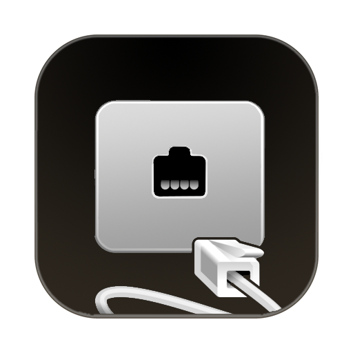

<p align="center">
  
</p>

# PxStation Windows

Le macchine virtuali **Proxmox VE** su Windows: elenco delle VM, alimentazione, connessione con
un clic e riconnessione automatica. Il protocollo **SPICE** è implementato in C# e lo schermo è
disegnato con Direct3D 11. Non servono remote-viewer né GTK.

> **PxStation Windows è un fork di windows-spice-client**, la versione per Windows di
> [macos-spice-client](https://github.com/pawelwiecaszek/macos-spice-client) di Paweł Więcaszek
> (licenza MIT), rinominato e mantenuto da Zenity.it. Progetti fratelli, con la stessa numerazione:
> [PxStation Mac](https://github.com/LucaMaroglio/pxstation-mac) e
> [PxStation Linux](https://github.com/LucaMaroglio/pxstation-linux).

## Novità 0.3.1

- Nuovo nome (PxStation Windows), nuova icona e finestra Informazioni con nome, versione e
  «2026 - Luca Maroglio».
- Interfaccia in inglese e in italiano, con la scelta della lingua in Preferenze › Generale
  (vedi [Lingua dell'interfaccia](#lingua-dellinterfaccia)).
- Versione allineata a PxStation Mac e PxStation Linux (0.3.1).

Restano invariati, per non perdere configurazioni e associazioni già presenti: l'identificativo
`org.windowsspiceclient.WindowsSpiceClient`, la cartella dei dati `%APPDATA%\WindowsSpiceClient`,
i nomi interni del codice (`WindowsSpiceClient`) e le variabili `WSC_*`.

> **Stato:** in sviluppo, milestone **M9** completata: file `.vv`, server Proxmox (elenco
> delle VM, alimentazione, connessione via API), Gestione credenziali, finestre Benvenuto,
> Macchine virtuali e Preferenze; connessione SPICE (TCP, TLS con la CA del file e
> `host-subject`, proxy CONNECT di Proxmox, ticket) con istanza unica; schermo della VM
> (immagini QUIC, LZ, GLZ, LZ4 e JPEG; flussi video MJPEG, H.264 e H.265 con Media Foundation)
> disegnato con Direct3D 11; tastiera (anche Alt+Tab e il tasto Windows), mouse in modalità client
> e server, cursore dell'ospite, Ctrl+Alt+Canc e schermo intero con le scorciatoie del `.vv`.
> Con spice-vdagent nella VM: risoluzione che segue la finestra, appunti condivisi (testo e
> immagini) e copia di file trascinandoli sullo schermo. Riconnessione automatica nella stessa
> finestra (le sessioni Proxmox ottengono un ticket nuovo dall'API). Audio della VM (PCM e Opus) e
> microfono, spento finché non lo accendi dal menu della sessione. Immagini ISO montate come
> CD-ROM USB e smartcard del PC condivise con la VM (serve una porta USB SPICE, *Spice Port* in
> Proxmox). Icona nell'area di notifica con le sessioni aperte (stato, Riprova ora, Annulla
> riconnessione, Alimentazione, Disconnetti), notifiche di Windows (connessione persa, riconnessa,
> sessione terminata con «Avvia e riconnetti»), attività nella jump list e installer Inno Setup.
> La condivisione di dispositivi USB reali (UsbDk) non c'è ancora.
> Il piano è in [PIANO.md](PIANO.md).
>
> Scorciatoie predefinite (come virt-viewer, sostituite da quelle del `.vv`): **Ctrl+Alt+R**
> rilascia mouse e tastiera, **Ctrl+Alt+Fine** invia Ctrl+Alt+Canc, **Maiusc+F11** passa allo
> schermo intero. Gli stessi comandi sono nel menu della barra del titolo.

## Lingua dell'interfaccia

Stesse regole di PxStation Mac e PxStation Linux:

1. la lingua scelta in **Preferenze › Generale › Lingua**, oppure
2. con «Predefinita di sistema», la prima lingua supportata fra le lingue preferite di Windows
   (Impostazioni › Data/ora e lingua › Lingua e area geografica), oppure
3. l'inglese, se nessuna delle lingue preferite è supportata.

Lingue disponibili: inglese (`Strings\en-US`, anche lingua di riserva) e italiano
(`Strings\it-IT`). Il cambio vale al riavvio dell'app. Per aggiungere una lingua: copiare
`Strings\en-US\Resources.resw` in `Strings\<tag>\`, tradurre i valori e aggiungere il tag a
`Language.Supported` (`Services/Language.cs`).

I messaggi d'errore di basso livello generati da SpiceKit (TLS, protocollo, decoder) sono
ancora solo in italiano.

## Requisiti

- Windows 10 22H2 o Windows 11, x64 o ARM64.
- Per compilare: .NET 10 SDK (basta l'installazione per utente) e git.

## Compilare

```powershell
tools\build.ps1              # build + test
tools\build.ps1 -SelfTest    # + autoverifica di renderer e interfaccia
tools\build.ps1 -Publish     # eseguibile autonomo in artifacts\win-x64
tools\build.ps1 -Proxmox     # + prova contro il finto Proxmox (..\windows-spike, Python)
tools\build.ps1 -Spice       # + prova SPICE contro QEMU per Windows (..\windows-spike, Python)
tools\build.ps1 -Installer   # + installer in artifacts\installer (serve Inno Setup 7)
```

## Installer

Serve **Inno Setup 7** (gratuito): scarica `innosetup-7.x.x.exe` da <https://jrsoftware.org/isdl.php>
e installalo (va bene «Installa solo per me», con la lingua italiana inclusa). Poi
`tools\build.ps1 -Installer` crea `artifacts\installer\PxStation-Win-<versione>-x64-setup.exe`.

L'installer non chiede permessi di amministratore (installa in `%LOCALAPPDATA%\Programs`, oppure per
tutti gli utenti se lo scegli). Aggiunge il collegamento nel menu Start e registra l'app per i file
`.vv`; il programma predefinito lo scegli tu, con «Apri con» o da Impostazioni > App > App predefinite.
La disinstallazione toglie anche notifiche e jump list. Impostazioni e token in Gestione credenziali
restano, per una reinstallazione: si eliminano dalle Preferenze, rimuovendo i server.

## Licenza

MIT. Protocollo, regole di sicurezza, fixture di test e icona derivano da MacOS Spice Client
© Paweł Więcaszek (MIT): vedi `NOTICE`.
